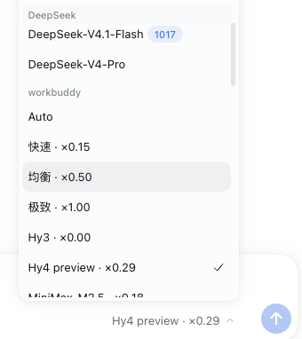

# dsh-workbuddy

在 **DeepSeek Harness（DSH）** 中使用 WorkBuddy 账号的模型与积分。聊天、上下文、工具审批和执行由 DSH 管理，模型请求通过本机 WorkBuddy 官方 CLI 完成。

- 在模型选择器中选择 `workbuddy` 分组，查看官方返回的积分倍率。
- 在插件详情查看总积分、分类余额、更新时间和模型目录。
- 支持流式文本、思考、工具调用、续聊以及请求诊断记录。



## 免责声明

**请完整阅读本节，充分了解风险后自行决定是否安装和使用。**

- **第三方接入存在账号风险。** 请遵守 WorkBuddy 的适用服务协议及平台规则。使用本项目可能导致账号或功能受限、**账号封禁**、服务暂停或终止。**即使调用和扣费正常，仍需自行确认接入授权并评估账号风险。**
- 本项目**仅供个人学习和研究使用**，仅使用本人 WorkBuddy 账号在本机调用，**请勿用于商业用途或超出个人合理使用范围的场景**。代码授权遵循本仓库的 [MIT 许可证](LICENSE)，使用平台账号和服务时还应遵守平台规则。
- 本项目按现状提供，**对服务持续可用、账号状态和积分展示准确性均不作保证**。平台的限制、处罚、计费规则及服务调整由平台决定；上游调整可能导致插件失效。
- **账号限制、额度损失、服务中断等使用后果，由使用者自行承担。** 安装前请充分了解并评估上述风险；建议优先使用**官方 WorkBuddy 客户端**。
- 在适用法律允许的范围内，本项目作者**对因使用或滥用本项目产生的直接或间接损失不承担责任**。
- 本项目与**腾讯、WorkBuddy、DeepSeek 均无关联，未获其授权或认可**。文中出现的名称仅用于描述兼容关系，**商标权利归各自所有**。

## 安装前准备

| 项目       | 当前要求                                               |
| ---------- | ------------------------------------------------------ |
| 运行位置   | 安装 DSH 的同一台 Mac                                  |
| WorkBuddy  | 安装在 `/Applications/WorkBuddy.app`，提供随附 CLI     |
| DSH        | 两套已验证版本，见 [版本兼容](docs/compatibility.md)   |
| Node.js    | `>=24.9.0`；使用命令行安装时需要可运行的 `dsh` 和 pnpm |
| 已验证版本 | WorkBuddy `5.9.3`，内置 CLI `2.165.0`                  |

**目前仅支持 macOS。**WorkBuddy 凭据保护格式和 CLI 协议随其版本变化，升级后的兼容性以具体版本的验证记录为准。

## 安装

### DSH 界面安装

1. 打开 DSH 的「插件」→「添加插件」。
2. 填入下面的预构建安装包地址，完成安装并选择「立即启用」。
3. 按下面的「关联 WorkBuddy 账号」确认登录，再选择模型。

```text
https://github.com/KtKID/dsh-workbuddy/releases/latest/download/dsh-workbuddy.tgz
```

该地址始终指向最新正式 Release 的安装包。安装包包含已构建的 `lib/`、界面模块和组合包配置，安装时可直接加载。包内的 DSH 依赖由当前宿主提供，`zod` 由包管理器安装。

### 命令行安装到 Web profile

```sh
dsh plugin --profile web add https://github.com/KtKID/dsh-workbuddy/releases/latest/download/dsh-workbuddy.tgz
dsh --profile web --dump-config
dsh web
```

`--dump-config` 的输出应包含 `dsh-workbuddy` 层及 `workbuddy` 插件行。对已经运行的实例，按 DSH 的安装结果提示应用变更或重新启动。其他 profile 将命令中的 `web` 替换为目标 profile 名称；Desktop 用户使用界面安装。

网络下载受限时，从 [最新 Release](https://github.com/KtKID/dsh-workbuddy/releases/latest) 下载 `dsh-workbuddy.tgz`，再用绝对路径安装：

```sh
dsh plugin --profile web add /absolute/path/dsh-workbuddy.tgz
```

### 从源码开发

```sh
git clone https://github.com/KtKID/dsh-workbuddy.git
cd dsh-workbuddy
pnpm install --frozen-lockfile
pnpm build
pnpm check
pnpm test
pnpm pack --pack-destination dist
```

构建依赖均从公开 npm 源获取。开发安装使用构建后的本地绝对目录，`dsh plugin --profile web add /absolute/path/dsh-workbuddy`。GitHub 仓库保存 TypeScript 源码，普通安装使用上面的 Release `.tgz`。

## 关联 WorkBuddy 账号

打开「插件 → WorkBuddy」详情页，选择一种方式关联本人账号。

- **本地已登录** 读取 WorkBuddy 桌面端的当前登录，或读取部署者配置的私有凭据文件。
- **网页登录** 点击「登录中国区」或「登录国际区」，在对应的 WorkBuddy 官方页面完成登录。插件单独保存网页凭据，本地凭据供插件只读使用。

两种方式同时可用时，点击「使用本地账号」或「使用网页账号」切换。积分、模型目录和新发起的对话使用标有「使用中」的账号。点击「退出网页登录」会移除插件保存的网页凭据。有可用本地账号时，插件恢复使用本地账号。网页登录到期后可以在详情页重新登录。本地登录到期时，在桌面端恢复登录，或重新导出私有凭据。

自定义安装位置、登录文件路径及凭据读取方式见 [使用与维护](docs/usage.md#登录与数据)。

## 查看额度与选择模型

打开「插件」中的 **WorkBuddy** 详情页，查看可用积分、套餐分类和模型目录。余额成功结果缓存五分钟；需要最新值时点击一次「刷新余额和模型」。查询失败时页面显示错误，并保留同账号上次成功的结果；账号切换后重新查询。

模型名称后的 `×0.11` 等数字是 WorkBuddy 返回的积分倍率。可用模型、调用权限和实际积分消耗由 WorkBuddy 服务端决定。CLI 提供单次 `credit` 时插件记录该值；缺值保留为未知，实际扣费以官方账单为准。聊天会话的自动标题生成也可能单独请求模型。

## 配置

用户配置写在目标 profile 的 `cordis.patch.yml` 中，行 id 为 `workbuddy`。按需设置以下字段，其他值使用默认配置：

```yaml
- id: workbuddy
  name: dsh-workbuddy
  config:
    transport: cli
    timeoutMs: 60000
    electronPath: /Applications/WorkBuddy.app/Contents/MacOS/Electron
```

完整配置、数据保存位置和故障处理见 [使用与维护](docs/usage.md)。

## 验证与维护

2026-11-04，官方 ACP 传输、原生与宿主工具、审批、跨步状态、用量和取消已在 60000 实际页面验收。独立包 70 项测试通过；实际页面、自动测试与平台覆盖范围见 [验证记录](docs/verification.md)。

插件使用官方 ACP SDK，提供账号详情页、安装配置及可选的 CLI 路径和私有凭据接入。维护问题提交到 [Issues](https://github.com/KtKID/dsh-workbuddy/issues)。

发布流程与 DSH 官方打包规则见 [发布说明](docs/releasing.md)。
